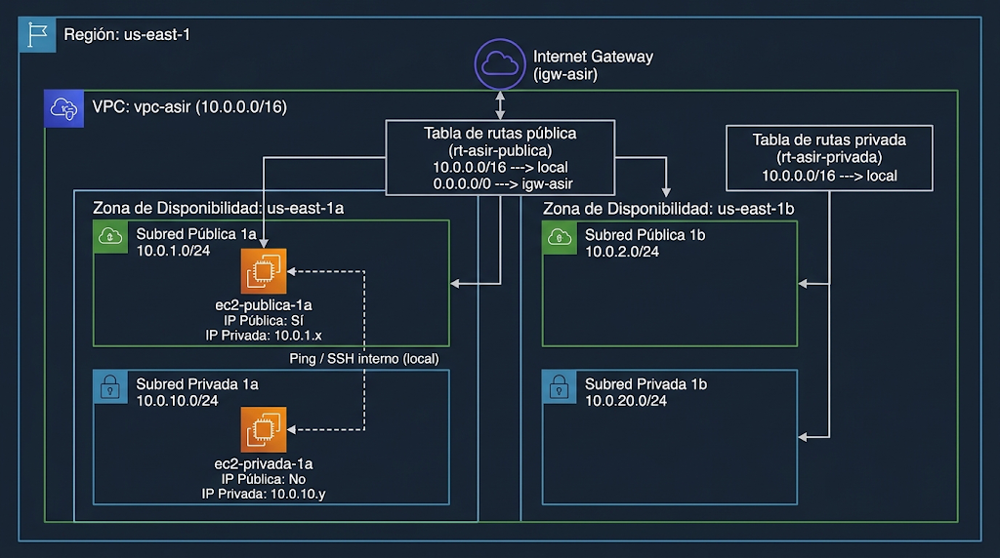

```
----------------- ADMINISTRACIÓN DE SISTEMAS INFORMATICOS EN RED ----------------
---------------------------------------------------------------------------------

Módulo:                     Computación en la nube (Optativa II)
Profesor:                   Víctor J. González
Unidad de Trabajo:          UT04. Redes y conectividad en la nube
Práctica:                   PR0401. Diseño y construcción de una VPC desde cero: Subredes públicas, privadas e Internet Gateway
Resultados de aprendizaje:  RA2
```

# PR0305.  Diseño y construcción de una VPC desde cero: Subredes públicas, privadas e Internet Gateway

## 1. Fundamentos teóricos

### Aislamiento lógico en la nube: Amazon VPC y direccionamiento CIDR

Hasta ahora hemos desplegado nuestros recursos utilizando la **Default VPC** (VPC por defecto) que AWS aprovisiona en cada región. Aunque resulta cómoda para pruebas rápidas, la VPC por defecto expone todas sus subredes directamente a Internet, lo cual es inaceptable en entornos de producción reales donde bases de datos y servidores de lógica de negocio deben permanecer ocultos.

Una **Amazon Virtual Private Cloud (VPC)** es una red virtual aislada a nivel lógico dentro de la nube de AWS, controlada íntegramente por el administrador. Al crear una VPC, se le asigna un rango de direcciones IPv4 privadas mediante notación **CIDR** (*Classless Inter-Domain Routing*), típicamente dentro de los rangos privados definidos en el RFC 1918 (`10.0.0.0/8`, `172.16.0.0/12`, `192.168.0.0/16`). AWS permite bloques CIDR desde una máscara `/16` (65.536 direcciones) hasta `/28` (16 direcciones).

Una VPC abarca **toda una Región de AWS** (por ejemplo, `us-east-1`), mientras que las **subredes (*Subnets*)** en las que dividimos ese bloque CIDR están vinculadas estrictamente a una **única Zona de Disponibilidad (AZ)** (como `us-east-1a` o `us-east-1b`).


### Direcciones IP reservadas por AWS

A diferencia de una red física tradicional donde el administrador solo pierde dos direcciones por cada subred, **AWS reserva siempre 5 direcciones IP en cada subred** (las 4 primeras y la última) para el funcionamiento interno de la infraestructura virtual.

Por ejemplo, en una subred con el rango `10.0.1.0/24` (256 direcciones en total), las siguientes IPs nunca podrán asignarse a una instancia EC2:

- **`10.0.1.0`:** Dirección de red.
- **`10.0.1.1`:** Reservada por AWS para el router implícito de la VPC (*VPC Router*).
- **`10.0.1.2`:** Reservada por AWS para el servidor DNS interno de la VPC.
- **`10.0.1.3`:** Reservada por AWS para uso futuro.
- **`10.0.1.255`:** Dirección de difusión (*Broadcast*) de red. AWS no soporta *broadcast* en una VPC, por lo que reserva y bloquea esta dirección.

Por tanto, una subred `/24` en AWS ofrece exactamente **251 direcciones IP utilizables** ($2^{8} - 5 = 251$).


### Subredes públicas frente a subredes privadas: Tablas de enrutamiento e Internet Gateway

En AWS no existe un botón o casilla de verificación que convierta mágicamente una subred en "pública" o "privada". **El carácter público o privado de una subred lo determina exclusivamente su Tabla de Enrutamiento (*Route Table*).**

Toda VPC cuenta con un router implícito que gestiona el tráfico entre subredes mediante la ruta `local` (que permite que todas las subredes de una misma VPC se vean entre sí por defecto). Para que los recursos puedan comunicarse con el exterior, entran en juego dos componentes:

1. **Internet Gateway (IGW):** es un componente de red redundante, escalable horizontalmente y de alta disponibilidad que conecta la VPC con Internet. Realiza dos funciones críticas: actúa como destino en las tablas de rutas para el tráfico dirigido a Internet y ejecuta la traducción de direcciones de red (**NAT 1:1**) de forma transparente para las instancias que tienen asignada una dirección IPv4 pública.
2. **Tablas de enrutamiento (*Route Tables*):** contienen el conjunto de reglas (*rutas*) que determinan hacia dónde se dirige el tráfico de red:
   - **Subred pública:** es aquella asociada a una tabla de enrutamiento que posee una ruta por defecto (`0.0.0.0/0`) apuntando directamente a un **Internet Gateway (`igw-xxxxxx`)**. Además, suele configurarse con el atributo *Auto-assign public IPv4 address* para que las máquinas que nazcan en ella reciban una IP pública automáticamente.
   - **Subred privada:** es aquella cuya tabla de enrutamiento **NO tiene una ruta hacia el Internet Gateway**. Su tabla solo contiene la ruta `local` (`10.0.0.0/16 -> local`), por lo que es físicamente imposible alcanzar sus instancias desde el exterior, incluso aunque por error se les asignara una IP pública o se abriera el puerto en su *Security Group*.


## 2. Diagrama de la arquitectura




## 3. Objetivos de la práctica

1. Aprovisionar manualmente una **Amazon VPC** personalizada (`10.0.0.0/16`) sin utilizar asistentes automatizados (*VPC Wizard*).
2. Diseñar y crear un esquema de direccionamiento multi-zona compuesto por **dos subredes públicas** y **dos subredes privadas** repartidas en dos Zonas de Disponibilidad (`us-east-1a` y `us-east-1b`)[cite: 1].
3. Desplegar y vincular un **Internet Gateway (IGW)** a la VPC.
4. Configurar y asociar explícitamente **Tablas de Enrutamiento** diferenciadas para dotar de salida a Internet a la capa pública y garantizar el aislamiento total de la capa privada.
5. Desplegar instancias de prueba y verificar empíricamente el enrutamiento interno (`local`), la salida a Internet de la capa pública y el aislamiento estricto de la capa privada.


## 4. Guía paso a paso

### Paso 1: Creación manual de la VPC

1. En la consola de AWS, navegar al servicio **VPC** > **Your VPCs** y pulsar en **Create VPC**.
2. Configurar los siguientes parámetros:
   - **Resources to create:** Seleccionar **`VPC only`** (*Importante: NO seleccionar "VPC and more", ya que construiremos cada pieza manualmente para comprender su interconexión*).
   - **Name tag:** `vpc-asir`
   - **IPv4 CIDR block:** `IPv4 CIDR manual input`
   - **IPv4 CIDR:** `10.0.0.0/16`
   - **IPv6 CIDR block:** `No IPv6 CIDR block`
   - **Tenancy:** `Default`
3. Pulsar en **Create VPC**.
4. Con la VPC recién creada seleccionada, hacer clic en el botón **Actions** > **Edit VPC settings**:
   - En la sección **DNS settings**, asegurarse de que tanto **Enable DNS resolution** como **Enable DNS hostnames** estén marcados.
   - Pulsar en **Save**.


### Paso 2: Creación del esquema de subredes (Públicas y Privadas)

1. En el menú lateral izquierdo de VPC, ir a **Subnets** y pulsar en **Create subnet**.
2. En **VPC ID**, seleccionar **`vpc-asir` (`10.0.0.0/16`)**.
3. Vamos a crear las **4 subredes** en un mismo lote pulsando el botón *Add new subnet* en la parte inferior para cada una de ellas:

   - **Subred 1 (Pública en Zona A):**
     - **Subnet name:** `subred-publica-1a`
     - **Availability Zone:** `US East (N. Virginia) / us-east-1a`[cite: 1]
     - **IPv4 subnet CIDR block:** `10.0.1.0/24`
   - **Subred 2 (Pública en Zona B):**
     - **Subnet name:** `subred-publica-1b`
     - **Availability Zone:** `US East (N. Virginia) / us-east-1b`[cite: 1]
     - **IPv4 subnet CIDR block:** `10.0.2.0/24`
   - **Subred 3 (Privada en Zona A):**
     - **Subnet name:** `subred-privada-1a`
     - **Availability Zone:** `US East (N. Virginia) / us-east-1a`[cite: 1]
     - **IPv4 subnet CIDR block:** `10.0.10.0/24`
   - **Subred 4 (Privada en Zona B):**
     - **Subnet name:** `subred-privada-1b`
     - **Availability Zone:** `US East (N. Virginia) / us-east-1b`[cite: 1]
     - **IPv4 subnet CIDR block:** `10.0.20.0/24`

4. Pulsar en **Create subnet**. Observar en el listado que la columna *Available IPv4 addresses* muestra **251** direcciones en cada una (las 256 del rango `/24` menos las 5 reservadas por AWS).
5. **Habilitar la asignación automática de IP pública en las dos subredes públicas:**
   - Seleccionar la casilla de `subred-publica-1a`, ir a **Actions** > **Edit subnet settings**.
   - Marcar la casilla **Enable auto-assign public IPv4 address** y pulsar en **Save**.
   - Repetir exactamente la misma operación para `subred-publica-1b`. (*Las dos subredes privadas deben mantener esta opción desactivada*).


### Paso 3: Creación y conexión del Internet Gateway (IGW)

1. En el menú lateral de VPC, ir a **Internet gateways** y pulsar en **Create internet gateway**.
2. **Name tag:** `igw-asir`. Pulsar en **Create internet gateway**.
3. Una vez creado, observar que su estado es `Detached` (desconectado). En la barra superior o en el menú **Actions**, seleccionar **Attach to VPC**.
4.En **Available VPCs**, elegir **`vpc-asir`** y pulsar en **Attach internet gateway**. El estado cambiará a `Attached`.


### Paso 4: Configuración de Tablas de Enrutamiento (Route Tables)

1. En el menú lateral de VPC, ir a **Route tables** y pulsar en **Create route table**.
2. **Crear la tabla de rutas pública:**
   - **Name:** `rt-asir-publica`
   - **VPC:** `vpc-asir`
   - Pulsar en **Create route table**.
3. En la pantalla de detalles de `rt-asir-publica`:
   - Ir a la pestaña **Routes** y pulsar en **Edit routes**.
   - Observar que ya existe la ruta `10.0.0.0/16 -> local` (que permite el tráfico interno dentro de la VPC).
   - Pulsar en **Add route**:
     - **Destination:** `0.0.0.0/0`
     - **Target:** Seleccionar **Internet Gateway** y elegir `igw-asir`.
   - Pulsar en **Save changes**.
   - Ir a la pestaña **Subnet associations** y pulsar en **Edit subnet associations**.
   - Marcar **`subred-publica-1a`** y **`subred-publica-1b`**. Pulsar en **Save associations**.
4. **Crear la tabla de rutas privada:**
   - Volver a **Route tables** y pulsar en **Create route table**.
   - **Name:** `rt-asir-privada`
   - **VPC:** `vpc-asir`
   - Pulsar en **Create route table**.
   - Comprobar en la pestaña **Routes** que **solo existe la ruta `10.0.0.0/16 -> local`** (*no añadiremos ninguna otra ruta*).
   - Ir a la pestaña **Subnet associations** > **Edit subnet associations**.
   - Marcar **`subred-privada-1a`** y **`subred-privada-1b`**. Pulsar en **Save associations**.

> **Comprobación visual:** En el menú lateral de VPC, hacer clic en **Your VPCs**, seleccionar `vpc-asir` y observar la pestaña inferior **Resource map**. Deberá visualizarse el mapa completo donde las dos subredes públicas enlazan con `rt-asir-publica` hacia `igw-asir`, mientras que las dos privadas finalizan en `rt-asir-privada` sin salida al exterior.


### Paso 5: Creación de los Security Groups en la nueva VPC

Los *Security Groups* pertenecen siempre a una VPC específica[cite: 1]. Crearemos dos grupos dentro de `vpc-asir`:

1. Ir a **EC2** > **Network & Security** > **Security Groups** y pulsar en **Create security group**[cite: 1].
2. **Security Group para la instancia pública:**
   - **Security group name:** `sg-asir-publico`[cite: 1]
   - **Description:** `Permitir SSH desde mi IP`[cite: 1]
   - **VPC:** **¡Importante!** Cambiar la VPC por defecto y seleccionar **`vpc-asir`**.
   - **Inbound rules:** Tipo `SSH`, Puerto `22`, Source: `My IP`[cite: 1].
   - Pulsar en **Create security group**.
3. **Security Group para la instancia privada:**
   - Pulsar en **Create security group**.
   - **Security group name:** `sg-asir-privado`
   - **Description:** `Permitir ping ICMP y SSH solo desde la red interna de la VPC`
   - **VPC:** Seleccionar **`vpc-asir`**.
   - **Inbound rules:**
     - **Regla 1:** Tipo `All ICMP - IPv4`, Source: `Custom` -> `10.0.0.0/16` (permite hacer `ping` desde cualquier subred de nuestra VPC).
     - **Regla 2:** Tipo `SSH`, Puerto `22`, Source: `Custom` -> elegir el grupo `sg-asir-publico` (encadenamiento de grupos de seguridad)[cite: 1].
   - Pulsar en **Create security group**.


### Paso 6: Despliegue de instancias EC2 de validación

1. Ir a **EC2** > **Instances** > **Launch instances**.
2. **Lanzar la instancia pública:**
   - **Name:** `ec2-publica-1a`
   - **AMI:** **Amazon Linux 2023 AMI**[cite: 1].
   - **Instance type:** `t2.micro` o `t3.micro`[cite: 1].
   - **Key pair:** Seleccionar el par de claves del laboratorio (`vockey` o clave propia)[cite: 1].
   - En **Network settings**, pulsar en **Edit**:
     - **VPC:** `vpc-asir`
     - **Subnet:** `subred-publica-1a` (`10.0.1.0/24`)
     - **Auto-assign public IP:** Verificar que aparece como `Enable` por defecto (gracias a la configuración del Paso 2).
     - **Firewall (security groups):** Seleccionar **Select existing security group** y elegir **`sg-asir-publico`**.
   - Pulsar en **Launch instance**.
3. **Lanzar la instancia privada:**
   - Volver a pulsar en **Launch instances**.
   - **Name:** `ec2-privada-1a`
   - **AMI:** **Amazon Linux 2023 AMI**[cite: 1].
   - **Instance type:** `t2.micro` o `t3.micro`[cite: 1].
   - **Key pair:** Seleccionar el mismo par de claves[cite: 1].
   - En **Network settings**, pulsar en **Edit**:
     - **VPC:** `vpc-asir`
     - **Subnet:** `subred-privada-1a` (`10.0.10.0/24`)
     - **Auto-assign public IP:** Verificar que aparece como `Disable`.
     - **Firewall (security groups):** Seleccionar **Select existing security group** y elegir **`sg-asir-privado`**.
   - Pulsar en **Launch instance**.


### Paso 7: Pruebas de diagnóstico y verificación de conectividad

1. En el panel de **Instances**, seleccionar `ec2-publica-1a` y anotar su **Public IPv4 address**[cite: 1] y su **Private IPv4 address** (que estará en el rango `10.0.1.x`).
2. Seleccionar `ec2-privada-1a`. Comprobar que el campo *Public IPv4 address* está vacío (`-`) y anotar su **Private IPv4 address** (que estará en el rango `10.0.10.y`).
3. Conectarse por SSH desde el terminal local a la instancia pública[cite: 1]:
   ```bash
   ssh -i "tu_clave.pem" ec2-user@<IP_PUBLICA_DE_EC2_PUBLICA>
   ```
4. **Prueba 1: Conectividad a Internet desde la subred pública.**
   Desde dentro de `ec2-publica-1a`, comprobar que la ruta `0.0.0.0/0 -> igw-asir` funciona correctamente lanzando un ping hacia los servidores DNS de Cloudflare o consultando nuestra IP pública de salida:
   ```bash
   ping -c 4 1.1.1.1
   curl -s https://checkip.amazonaws.com
   ```
   *Resultado esperado:* Los 4 paquetes ICMP reciben respuesta con 0% de pérdida y `curl` nos devuelve la IP pública asignada a nuestra instancia.

5. **Prueba 2: Enrutamiento interno entre subredes de la VPC (`local` route).**
   Desde la misma sesión SSH en `ec2-publica-1a`, hacer un ping a la dirección **IP privada** de `ec2-privada-1a` (`10.0.10.y`):
   ```bash
   # Sustituir por la IP privada real de ec2-privada-1a
   ping -c 4 10.0.10.X
   ```
   *Resultado esperado:* A pesar de estar en subredes distintas (`10.0.1.0/24` y `10.0.10.0/24`), el *VPC Router* enruta los paquetes internamente gracias a la regla `10.0.0.0/16 -> local` presente en ambas tablas de enrutamiento, y el *Security Group* `sg-asir-privado` autoriza el tráfico ICMP interno.

6. **Prueba 3: Reflexión y planteamiento del reto para la PR0402.**
   La instancia `ec2-privada-1a` está ahora mismo completamente aislada de Internet: nadie puede atacarla desde fuera, pero si nos conectáramos a ella y ejecutáramos `sudo dnf update -y`[cite: 1], el comando quedaría bloqueado hasta dar *timeout* porque su tabla de rutas (`rt-asir-privada`) no sabe cómo llegar a `0.0.0.0/0`.

   > **Nota importante:** Si estás trabajando en el entorno **AWS Academy Learner Lab**, **NO elimines esta VPC ni sus subredes al finalizar la sesión**. Al detener el laboratorio (*Stop Lab*), las instancias EC2 se apagarán pero toda la topología de red (`vpc-asir`, subredes, tablas de rutas e IGW) se conservará intacta para continuar directamente sobre ella en la práctica **PR0402** (donde desplegaremos un *Bastion Host* y un *NAT Gateway*).