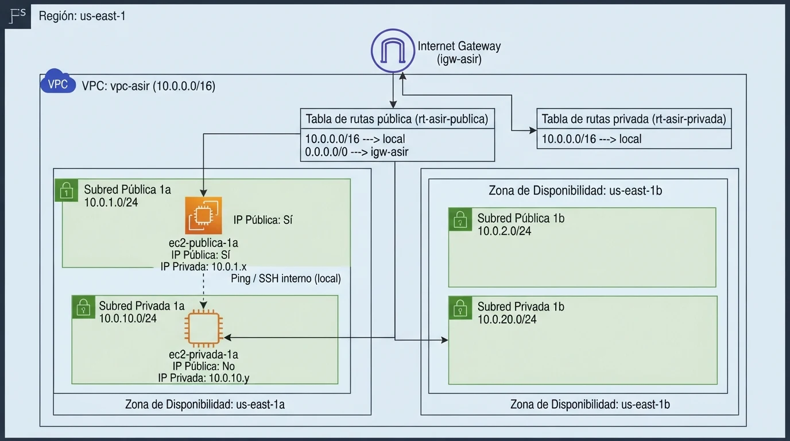

```markdown
----------------- ADMINISTRACIÓN DE SISTEMAS INFORMÁTICOS EN RED ----------------
---------------------------------------------------------------------------------

Módulo:                     Computación en la nube (Optativa II)
Profesor:                   Víctor J. González
Unidad de Trabajo:          UT04. Redes y conectividad en la nube
Práctica:                   PR0402. Conectividad saliente y administración segura en redes privadas: NAT Gateway y Bastion Host
Resultados de aprendizaje:  RA2 
```

# PR0402: Conectividad saliente y administración segura en redes privadas: NAT Gateway y Bastion Host

## 1. Fundamentos teóricos

### El dilema de las subredes privadas: salir sin ser visibles

En la práctica anterior construimos la topología `vpc-asir` (`10.0.0.0/16`) y comprobamos que la instancia `ec2-privada-1a`, ubicada en `subred-privada-1a` (`10.0.10.0/24`), está aislada de Internet: su tabla de enrutamiento `rt-asir-privada` solo contiene la ruta local (`10.0.0.0/16 -> local`) y no tiene IP pública.

Ese aislamiento protege al servidor frente a accesos no deseados desde Internet, pero crea dos necesidades operativas habituales en administración de sistemas:

1. **Conectividad saliente controlada:** el sistema operativo y las aplicaciones en una subred privada necesitan descargar actualizaciones (por ejemplo, con `dnf update`), instalar paquetes o consultar APIs externas, sin que Internet pueda iniciar conexiones hacia ellas.
2. **Administración remota segura:** como la instancia privada no tiene IP pública, no podemos conectarnos a ella directamente desde nuestro equipo local.

### NAT Gateway frente a NAT Instance

Para dar salida a Internet únicamente a tráfico originado dentro de la VPC (tráfico saliente), se utiliza Traducción de Direcciones de Red (**NAT**). En AWS disponemos de dos enfoques:

- **NAT Gateway:** es un servicio de red gestionado por AWS, de alta disponibilidad dentro de su Zona de Disponibilidad y con ancho de banda elástico (hasta varios Gbps). Requiere ubicarse obligatoriamente en una subred pública y asociarse a una dirección IP Elástica. No requiere administrar sistema operativo ni parches de seguridad, aunque tiene un coste por hora y por gigabyte procesado.
- **NAT Instance:** es una instancia EC2 configurada manualmente para actuar como router NAT. Es más económica en entornos de laboratorio o de bajo tráfico continuo, pero exige gestionar el sistema operativo, deshabilitar el chequeo *Source/Destination Check* en la interfaz de red y asume el límite de cómputo de la instancia.

En esta práctica desplegaremos un **NAT Gateway** en la subred pública `subred-publica-1a` y actualizaremos `rt-asir-privada` para dirigir el tráfico `0.0.0.0/0` hacia él.

### Administración segura: Bastion Host y SSH ProxyJump

Para administrar por SSH una máquina situada en una subred privada, una solución clásica es utilizar un **Bastion Host** (o servidor de salto): una instancia endurecida situada en una subred pública con acceso SSH restringido (por ejemplo, a nuestra IP) que actúa como punto intermedio para alcanzar las instancias privadas dentro de la VPC.

Al conectar a través de un bastión, es recomendable evitar copiar claves privadas (`.pem`) al disco del servidor de salto. Con OpenSSH podemos usar la opción **ProxyJump (`-J`)**, que encadena la conexión desde nuestro equipo local pasando por el bastión hasta la instancia privada sin dejar la clave privada almacenada en el bastión.

Como alternativa moderna sin necesidad de abrir el puerto 22 ni usar un bastión, AWS ofrece **Systems Manager (SSM) Session Manager**, que permite abrir sesiones *shell* mediante agentes y políticas IAM. En esta práctica trabajaremos con el patrón de *Bastion Host* y encadenamiento de *Security Groups* para consolidar conceptos de red y cortafuegos.

## 2. Diagrama de la arquitectura



## 3. Objetivos de la práctica

1. Reservar una **Elastic IP (EIP)** y desplegar un **NAT Gateway** en una subred pública de la VPC `vpc-asir`.
2. Actualizar la tabla de rutas privada (`rt-asir-privada`) para permitir el tráfico saliente a Internet (`0.0.0.0/0`) a través del NAT Gateway manteniendo el aislamiento frente a conexiones entrantes desde Internet.
3. Desplegar un **Bastion Host** (`ec2-bastion-1a`) en la subred pública y aplicar el encadenamiento de *Security Groups* para permitir SSH hacia la instancia privada únicamente desde el *Security Group* del bastión.
4. Conectarse desde el equipo local a la instancia privada mediante **SSH ProxyJump (`-J`)** y verificar tanto la salida a Internet como el bloqueo a conexiones entrantes no autorizadas.

## 4. Guía paso a paso

### Paso 1: Reserva de Elastic IP y creación del NAT Gateway

1. En la consola de AWS, ir al servicio **VPC** > **Elastic IPs** y pulsar en **Allocate Elastic IP address**.
2. Dejar la configuración por defecto (*Amazon's pool of IPv4 addresses*, *Network border group* de la región actual) y pulsar en **Allocate**. Anotar la IP pública asignada.
3. En el menú lateral de VPC, ir a **NAT gateways** y pulsar en **Create NAT gateway**.
4. Configurar los siguientes parámetros:
- **Name:** `nat-asir`
- **Subnet:** Seleccionar `subred-publica-1a` (`10.0.1.0/24`).
- **Connectivity type:** `Public`.
- **Elastic IP allocation ID:** Seleccionar la Elastic IP reservada en el paso 2.
5. Pulsar en **Create NAT gateway** y esperar unos minutos hasta que su estado cambie de `Pending` a `Available`.

### Paso 2: Actualización de la tabla de rutas privada (`rt-asir-privada`)

1. En el menú lateral de VPC, ir a **Route tables** y seleccionar `rt-asir-privada`.
2. Ir a la pestaña **Routes** y pulsar en **Edit routes**.
3. Mantener la ruta existente `10.0.0.0/16 -> local` y pulsar en **Add route**:
    - **Destination:** `0.0.0.0/0`
    - **Target:** Seleccionar **NAT Gateway** y elegir `nat-asir`.
4. Pulsar en **Save changes**.
5. Comprobar en la pestaña **Subnet associations** que `subred-privada-1a` y `subred-privada-1b` siguen asociadas a `rt-asir-privada`.

### Paso 3: Preparación de Security Groups para el Bastion Host y la instancia privada

1. Ir a **EC2** > **Network & Security** > **Security Groups** y pulsar en **Create security group**.
2. Crear el *Security Group* del Bastion:
    - **Security group name:** `sg-asir-bastion`
    - **Description:** `Permitir SSH hacia el Bastion Host desde mi IP`
    - **VPC:** Seleccionar `vpc-asir`.
    - **Inbound rules:** Tipo `SSH`, Puerto `22`, Source: `My IP`.
    - Pulsar en **Create security group**.
3. Actualizar el *Security Group* de la instancia privada (`sg-asir-privado`):
    - Seleccionar `sg-asir-privado`, ir a **Inbound rules** y pulsar en **Edit inbound rules**.
    - Asegurar que se mantiene la regla ICMP desde `10.0.0.0/16`.
    - En la regla de SSH (Puerto `22`), cambiar el origen para que apunte exclusivamente a `sg-asir-bastion` (encadenamiento de *Security Groups*).
    - Pulsar en **Save rules**.


### Paso 4: Despliegue del Bastion Host y verificación de la instancia privada

1. Ir a **EC2** > **Instances** > **Launch instances**.
2. Configurar la instancia del Bastion:
    - **Name:** `ec2-bastion-1a`
    - **AMI:** **Amazon Linux 2023 AMI**.
    - **Instance type:** `t2.micro` o `t3.micro`.
    - **Key pair:** Seleccionar el par de claves del laboratorio.
    - En **Network settings** > **Edit**:
    - **VPC:** `vpc-asir`
    - **Subnet:** `subred-publica-1a` (`10.0.1.0/24`)
    - **Auto-assign public IP:** `Enable`
    - **Firewall (security groups):** *Select existing security group* -> `sg-asir-bastion`.
3. Pulsar en **Launch instance**.
4. Si la instancia `ec2-privada-1a` de la práctica anterior estaba detenida, iniciarla desde **Instances** > **Instance state** > **Start instance** y anotar su IP privada (por ejemplo, `10.0.10.x`). Anotar también la IP pública de `ec2-bastion-1a`.

### Paso 5: Conexión mediante SSH ProxyJump y pruebas de conectividad

1. Desde una terminal en tu equipo local, conéctate a `ec2-privada-1a` utilizando `ec2-bastion-1a` como salto intermedio mediante *ProxyJump* (`-J`) con `ssh -i "tu_clave.pem" -J ec2-user@<IP_PUBLICA_BASTION> ec2-user@<IP_PRIVADA_EC2_PRIVADA>`
2. **Prueba 1: Conectividad saliente a Internet desde la subred privada a través del NAT Gateway.** una vez dentro de `ec2-privada-1a`, ejecuta `curl -s https://checkip.amazonaws.com` y `sudo dnf check-update`. `curl` debería devolver la Elastic IP del NAT Gateway (no una IP pública directa de la instancia privada) y `dnf` comprueba repositorios sin quedarse bloqueado por *timeout*.
3. **Prueba 2: Verificación del aislamiento frente a conexiones entrantes.** desde tu equipo local, intenta conectarte directamente por SSH a la IP privada de `ec2-privada-1a` (o comprueba que no tiene IP pública): la conexión directa desde el exterior no es posible, demostrando que el NAT Gateway facilita la salida pero no abre puertas de entrada hacia la subred privada.

> **Nota importante:** Si trabajas en **AWS Academy Learner Lab**, recuerda que los NAT Gateways y las Elastic IPs generan consumo mientras el laboratorio está activo. Al terminar la sesión o la práctica, sigue las indicaciones del profesor sobre qué recursos detener o liberar (especialmente el NAT Gateway y su Elastic IP si ya no se van a utilizar en el momento) para no agotar el crédito del laboratorio. Si vas a continuar con la siguiente práctica, conserva la topología base de `vpc-asir` y sus subredes.